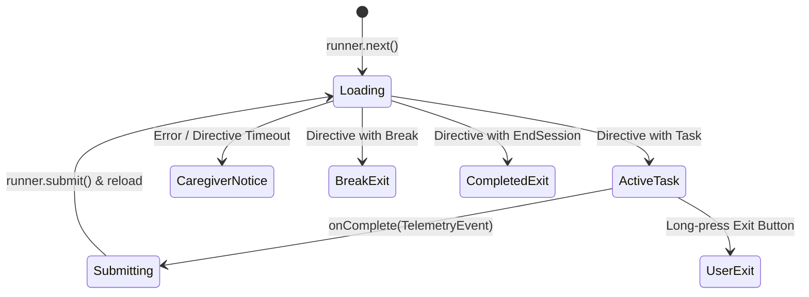
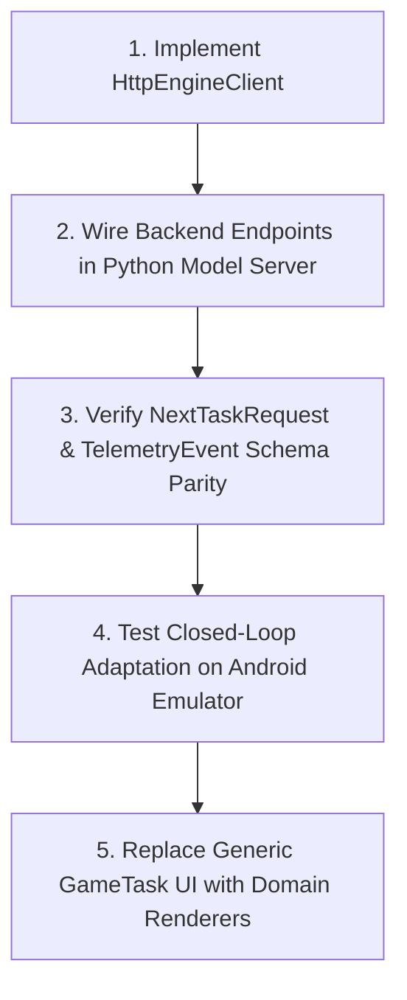

# Grow21 Frontend — Technical Audit and Architecture Report

> **Target Audience:** Engineering team and Claude (AI integration engineer)  
> **Repository:** `https://github.com/AadeeshRS/grow_21.git`  
> **Branch:** `ui-game`  
> **Status:** Published and Verified  
> **Date:** October 2026  

> **Update (integration branch `grow21-integration-ui`):** the per-game skill IDs in section C were replaced by the backend's six configured skills (see `src/games.ts`), and `HttpEngineClient` now exists. Section F was the plan; the implemented contract is in the backend's `docs/integration/FRONTEND_BACKEND_API.md`.

---

## Executive Summary

The `grow21-game-module` repository contains a modular React Native TypeScript package designed to run cognitive, motor, and verbal skill-building games for learners. The architecture strictly decouples learner state estimation and adaptive curriculum decisions from game presentation: the frontend acts as a task runner and telemetry emission surface governed by an external `EngineClient` and native `HostBridge`.

This document provides a comprehensive technical audit of the codebase, detailing project structure, architecture, game configuration mathematics, telemetry contracts, observable signals, integration gaps, and the recommended sequence for connecting this frontend to the Grow21 Python adaptive learner model.

---

## A. Project Overview

### 1. Framework, Language, and Runtime
- **Core Library:** React Native `>=0.72` (peer dependency), React `>=18` (peer dependency).
- **Demo Host Runtime:** Expo `~52.0.0` with React Native `0.76.1` and React `18.3.1`.
- **Language:** TypeScript `^5.0.0` (root manifest) / `^5.3.3` (demo app).
- **Target Platform:** Android (primary target, package `com.grow21.gamedemo`), iOS compatible.

### 2. Project Purpose
The module encapsulates:
1. The 9 Grow21 difficulty mappings and cumulative scaffold controller (Levels 0–3).
2. Pure mathematical interpolation functions (`lerp`, `roundLerp`, `clamp`) for game parameterization.
3. Strongly-typed engine directive and telemetry event schemas.
4. A session lifecycle runner enforcing task validation, timeouts, fallback repeats, and break notifications.
5. A generic, child-safe interaction surface for task presentation and telemetry dispatch.

### 3. Folder and File Structure
```
grow21-game-module/
├── .gitignore                  # Git exclusion rules (node_modules, dist, .expo, .env)
├── README.md                   # Module integration and usage guide
├── package.json                # Root package manifest (library mode)
├── tsconfig.json               # Root TypeScript configuration (ES2020, Bundler)
├── demo/                       # Standalone Expo demonstration host
│   ├── app.json                # Expo application manifest
│   ├── App.tsx                 # Demo entry point hosting Grow21GameModule
│   ├── metro.config.js         # Metro bundler config watching workspace root
│   ├── package.json            # Expo host dependencies
│   ├── package-lock.json       # Pinned dependency lockfile
│   └── README.md               # Local demo launch instructions
├── docs/
│   ├── OPEN_ITEMS.md           # Tracked specification and implementation gaps
│   └── GROW21_FRONTEND_TECHNICAL_REPORT.md  # This document
└── src/
    ├── config.ts               # Default timeouts, scaffold parameters, math helpers
    ├── games.ts                # 9 game definitions, difficultyConfig, applyScaffold
    ├── GameTask.tsx            # Task rendering surface and attempt lifecycle
    ├── index.tsx               # Library entry point (Grow21GameModule component)
    ├── MockEngine.ts           # Development mock adaptive engine
    ├── MockHostBridge.ts       # Development mock native platform bridge
    ├── ScaffoldController.ts   # Pure cumulative scaffold state machine
    ├── SessionRunner.ts        # Session coordinator, telemetry submitter, timeouts
    └── types.ts                # TypeScript domain models and event contracts
```

### 4. Main Entry Points
- **Module Root:** [src/index.tsx](file:///d:/BMU/BMU%20SEM%205/PRJ-1/grow21-game-module/src/index.tsx) exports `Grow21GameModule`, types, game helpers, and mock clients.
- **Standalone Demo Host:** [demo/App.tsx](file:///d:/BMU/BMU%20SEM%205/PRJ-1/grow21-game-module/demo/App.tsx) provides a full test environment mounting `Grow21GameModule` with mock services.

### 5. Major Dependencies
- **Root (`package.json`):**
  - Peer: `react >=18`, `react-native >=0.72`
  - Dev: `@types/react ^18.2.0`, `typescript ^5.0.0`
- **Demo (`demo/package.json`):**
  - `expo`: `~52.0.0`
  - `expo-asset`: `~11.0.1`
  - `react`: `18.3.1`
  - `react-native`: `0.76.1`
  - `typescript`: `^5.3.3`

---

## B. Architecture

### 1. Navigation and Screen Structure
The project intentionally does not use React Navigation or any third-party routing library. Navigation is managed as a state-driven single-screen lifecycle inside `Grow21GameModule`:

- **Loading State:** Shows an `ActivityIndicator` with `"Getting the next activity…"`.
- **Error State:** Renders caregiver guidance: `"We need a moment. Please return to your caregiver."`.
- **Exit Action:** A persistent top-right button (`s.exit`) triggers `onExit('userExit')` on long-press to prevent accidental child touches.

### 2. Component Organization
- **`Grow21GameModule` ([src/index.tsx](file:///d:/BMU/BMU%20SEM%205/PRJ-1/grow21-game-module/src/index.tsx)):**
  - Instantiates `SessionRunner` via `useMemo`.
  - Coordinates asynchronous directive retrieval and telemetry dispatch.
  - Passes clamped difficulty $D \in [0, 1]$ and starting scaffold level to `GameTask`.
- **`GameTask` ([src/GameTask.tsx](file:///d:/BMU/BMU%20SEM%205/PRJ-1/grow21-game-module/src/GameTask.tsx)):**
  - Manages trial presentation time (`presented.current = performance.now()`).
  - Owns local `ScaffoldController` instance.
  - Updates attempt records, latencies, and scaffold hints.
  - Emits fully populated `TelemetryEvent` upon trial completion or exhaustion.

### 3. State Management Approach
State is divided cleanly between reactive UI state and class-based domain controllers:
1. **`SessionRunner` ([src/SessionRunner.ts](file:///d:/BMU/BMU%20SEM%205/PRJ-1/grow21-game-module/src/SessionRunner.ts)):**
   - Tracks session active duration (`sessionActiveMs`), task completions count (`completed`), and previous task cache for fallback retries.
   - Validates directives: strictly rejects schemas that do not contain exactly one directive shape (task, break, or endSession), or that feature game-to-skill mismatches.
2. **`ScaffoldController` ([src/ScaffoldController.ts](file:///d:/BMU/BMU%20SEM%205/PRJ-1/grow21-game-module/src/ScaffoldController.ts)):**
   - Tracks current scaffold level $L \in \{0, 1, 2, 3\}$.
   - Escalates level after `failuresPerScaffoldLevel = 2` failures at the current level.
   - Marks `exhausted = true` and finishes when failure occurs at $L_{\max} = 3$.

### 4. Styling and Asset Management
- **Styling:** Vanilla React Native `StyleSheet.create`. No Tailwind CSS or external CSS engine is bundled. Colors follow a curated palette (`#21355a`, `#f7fbff`, `#dff6ff`, `#40ad72`, `#5a83c9`).
- **Assets:** The repository contains no static audio clips, image files, or Skia canvas implementations. The current task surface renders illustrative Unicode emoji representations (`🐘`, `🫧`, `🍎 🍌 🍎 ?`, `✨`).

### 5. Existing Networking Architecture
- The module contains no direct HTTP/Fetch/Axios networking layer.
- Instead, network communication is inverted via the `EngineClient` interface:
  ```typescript
  export interface EngineClient {
    getNextTask(request: NextTaskRequest): Promise<TaskDirective>;
    submitTelemetry(event: TelemetryEvent): Promise<{ ack: true }>;
  }
  ```
- In development/demo mode, `MockEngine` fulfills this interface in memory. Connecting to the real Python backend requires providing an `EngineClient` implementation that serializes these payloads over HTTP.

---

## C. Game Implementation Matrix

The nine games spanning Motor, Verbal/Language, and Cognitive domains are defined in [src/games.ts](file:///d:/BMU/BMU%20SEM%205/PRJ-1/grow21-game-module/src/games.ts):

| Domain | Game Key | Game Name | Target Skill ID | Current Completeness |
| :--- | :--- | :--- | :--- | :--- |
| **Motor** | `trace` | Trace & Glow | `fine_motor_tracing` | Architecture & config complete; renderer generic |
| **Motor** | `bubble` | Bubble Pop Brigade | `motor_targeting` | Architecture & config complete; renderer generic |
| **Motor** | `block` | Block Stacker | `drag_precision` | Architecture & config complete; renderer generic |
| **Verbal** | `echo` | Echo Safari | `vocal_activation` | Architecture & config complete; renderer generic |
| **Verbal** | `sentence` | Picture-Sentence Strips | `sentence_sequencing` | Architecture & config complete; renderer generic |
| **Verbal** | `audio` | Audio Search | `receptive_language` | Architecture & config complete; renderer generic |
| **Cognitive** | `sort` | Category Sorting | `classification` | Architecture & config complete; renderer generic |
| **Cognitive** | `flip` | Visual Flip Match | `visual_working_memory` | Architecture & config complete; renderer generic |
| **Cognitive** | `pattern` | Pattern Train | `visual_sequencing` | Architecture & config complete; renderer generic |

### Detailed Game Inspection

#### 1. Trace & Glow (`trace`)
- **Files:** [src/games.ts](file:///d:/BMU/BMU%20SEM%205/PRJ-1/grow21-game-module/src/games.ts#L5), [src/GameTask.tsx](file:///d:/BMU/BMU%20SEM%205/PRJ-1/grow21-game-module/src/GameTask.tsx).
- **Difficulty Config ($D \in [0, 1]$):**
  - `pathWidthDp`: $120 \to 44$
  - `pathLengthDp`: $220 \to 620$
  - `curvature`: $0.0 \to 0.8$
  - `turnCount`: $0 \to 6$
  - `shapeType`: `'straight'` ($<0.2$), `'gentleCurve'` ($<0.5$), `'zigzag'` ($<0.8$), `'shapes'` ($\ge 0.8$)
- **Scaffold Adjustments:**
  - $L \ge 1$: `pathWidthDp` $\times 1.2$, `strongGlow = true`
  - $L \ge 2$: `resumeRadiusMultiplier = 2`
  - $L \ge 3$: `ghostTrail = true`, `maximumTolerance = true`
- **Current Interaction:** Generic button simulation ("Try again" / "I found it!"). Touch tracing metrics (`motor.pathPoints`, deviation) are defined in schemas but require a touch/Skia renderer.

#### 2. Bubble Pop Brigade (`bubble`)
- **Files:** [src/games.ts](file:///d:/BMU/BMU%20SEM%205/PRJ-1/grow21-game-module/src/games.ts#L6).
- **Difficulty Config ($D \in [0, 1]$):**
  - `bubbleSizeDp`: $140 \to 70$
  - `speedDpPerSec`: $30 \to 90$
  - `concurrentBubbles`: $1 \to 5$
  - `minSeparationDp`: $200 \to 80$
  - `popTarget`: 5
- **Scaffold Adjustments:**
  - $L \ge 1$: `bubbleSizeDp` $\times 1.15$, `speedDpPerSec` $\times 0.8$
  - $L \ge 2$: `concurrentBubbles = min(2, n)`, `hint = true`
  - $L \ge 3$: `concurrentBubbles = 1`, `hitPaddingDp = 16`, `speedDpPerSec = 30`

#### 3. Block Stacker (`block`)
- **Files:** [src/games.ts](file:///d:/BMU/BMU%20SEM%205/PRJ-1/grow21-game-module/src/games.ts#L7).
- **Difficulty Config ($D \in [0, 1]$):**
  - `blockCount`: $1 \to 5$
  - `blockSizeDp`: $110 \to 60$
  - `placementToleranceDp`: $56 \to 18$
  - `structure`: `'single'` ($<0.25$), `'row'` ($<0.5$), `'stack'` ($<0.75$), `'pattern'` ($\ge 0.75$)
- **Scaffold Adjustments:**
  - $L \ge 1$: `blockSizeDp` $\times 1.15$, `placementToleranceDp` $\times 1.3$
  - $L \ge 2$: `snapMultiplier = 2`, `highlight = true`
  - $L \ge 3$: `blockCount = min(2, n)`, `pulseTarget = true`

#### 4. Echo Safari (`echo`)
- **Files:** [src/games.ts](file:///d:/BMU/BMU%20SEM%205/PRJ-1/grow21-game-module/src/games.ts#L8).
- **Difficulty Config ($D \in [0, 1]$):**
  - `promptVariety`: $2 \to 6$
  - `repetitions`: $1 \to 3$
  - `responseWindowMs`: $8000 \to 4000$
  - `demand`: `'single'` ($<0.7$), `'twoSound'` ($\ge 0.7$)
- **Scaffold Adjustments:**
  - $L \ge 1$: `repeatModel = 1`
  - $L \ge 2$: `strongCue = true`, `responseWindowMs` $\times 1.5$
  - $L \ge 3$: `repeatModel = 2`, `repetitions = 1`
- **Audio Note:** As noted in the Grow21 specification, Echo Safari baseline requires voice activity / vocal activation, not full speech-to-text phoneme alignment.

#### 5. Picture-Sentence Strips (`sentence`)
- **Files:** [src/games.ts](file:///d:/BMU/BMU%20SEM%205/PRJ-1/grow21-game-module/src/games.ts#L9).
- **Difficulty Config ($D \in [0, 1]$):**
  - `sentenceLength`: $2 \to 5$
  - `vocabLevel`: 1 ($<0.34$), 2 ($<0.67$), 3 ($\ge 0.67$)
  - `distractorCount`: $0 \to 4$
  - `structureType`: `'SV'` ($<0.4$), `'SVO'` ($<0.75$), `'SVOmodifier'` ($\ge 0.75$)
- **Scaffold Adjustments:**
  - $L \ge 1$: `distractorCount` $\times 0.5$
  - $L \ge 2$: `highlightNext = true`, `sentenceLength = max(2, n - 1)`
  - $L \ge 3$: `workedExample = true`, `distractorCount = 0`

#### 6. Audio Search (`audio`)
- **Files:** [src/games.ts](file:///d:/BMU/BMU%20SEM%205/PRJ-1/grow21-game-module/src/games.ts#L10).
- **Difficulty Config ($D \in [0, 1]$):**
  - `optionCount`: $2 \to 3$
  - `visualSimilarity`: $0.0 \to 0.7$
  - `attributeCount`: $1 \to 3$
  - `instructionComplexity`: $1 \to 3$
- **Scaffold Adjustments:**
  - $L \ge 1$: `repeatInstruction = true`
  - $L \ge 2$: `optionCount = 2`, `visualSimilarity = 0`
  - $L \ge 3$: `attributeCount = 1`, `instructionComplexity = 1`, `instructionRepeats = 2`
- **Receptive Note:** Receptive language task; measures selection reaction and accuracy upon spoken instruction, requiring no child microphone input.

#### 7. Category Sorting (`sort`)
- **Files:** [src/games.ts](file:///d:/BMU/BMU%20SEM%205/PRJ-1/grow21-game-module/src/games.ts#L11).
- **Difficulty Config ($D \in [0, 1]$):**
  - `itemCount`: $3 \to 8$
  - `categoryCount`: 2
  - `categorySimilarity`: $0.0 \to 0.6$
  - `attributeComplexity`: 1 ($<0.6$), 2 ($\ge 0.6$)
  - `placementToleranceDp`: $64 \to 28$
- **Scaffold Adjustments:**
  - $L \ge 1$: `clearLabels = true`, `placementToleranceDp` $\times 1.25$
  - $L \ge 2$: `itemCount = min(4, n)`, `example = true`
  - $L \ge 3$: `highlightBin = true`, `snapToBin = true`

#### 8. Visual Flip Match (`flip`)
- **Files:** [src/games.ts](file:///d:/BMU/BMU%20SEM%205/PRJ-1/grow21-game-module/src/games.ts#L12).
- **Difficulty Config ($D \in [0, 1]$):**
  - `cardCount`: 4 ($<0.5$), 6 ($\ge 0.5$)
  - `visualSimilarity`: $0.0 \to 0.6$
  - `exposureMs`: $4000 \to 1500$
  - `loadLevel`: 1 ($<0.34$), 2 ($<0.67$), 3 ($\ge 0.67$)
- **Scaffold Adjustments:**
  - $L \ge 1$: `exposureMs` $\times 1.5$
  - $L \ge 2$: `cardCount = 4`, `visualSimilarity = 0`
  - $L \ge 3$: `demo = true`, `cardCount = 4`

#### 9. Pattern Train (`pattern`)
- **Files:** [src/games.ts](file:///d:/BMU/BMU%20SEM%205/PRJ-1/grow21-game-module/src/games.ts#L13).
- **Difficulty Config ($D \in [0, 1]$):**
  - `sequenceLength`: $3 \to 7$
  - `ruleCount`: 1 ($<0.4$), 2 ($<0.75$), 3 ($\ge 0.75$)
  - `distractorCount`: $1 \to 4$
  - `visualSimilarity`: $0.0 \to 0.6$
- **Scaffold Adjustments:**
  - $L \ge 1$: `distractorCount = max(1, n - 1)`
  - $L \ge 2$: `highlightUnit = true`, `sequenceLength = max(3, n - 1)`
  - $L \ge 3$: `answerChoices = 2`, `animateUnit = true`

---

## D. Interaction Event Inventory

The frontend emits one structured `TelemetryEvent` at the completion or failure of every task.

| Signal Field | Type | Current Implementation Status | Source / Instrumentation Required |
| :--- | :--- | :--- | :--- |
| `schemaVersion` | `1` | Implemented (constant) | [src/types.ts](file:///d:/BMU/BMU%20SEM%205/PRJ-1/grow21-game-module/src/types.ts#L6) |
| `eventId` | `string` | Implemented (UUID/timestamp) | `uid()` in [src/GameTask.tsx](file:///d:/BMU/BMU%20SEM%205/PRJ-1/grow21-game-module/src/GameTask.tsx#L2) |
| `childId` | `string` | Implemented (from props) | Passed through `Grow21GameModule` props |
| `sessionId` | `string` | Implemented (from props) | Passed through `Grow21GameModule` props |
| `gameId` | `GameId` | Implemented | Selected by engine directive |
| `skillId` | `SkillId` | Implemented | Enforced via `SKILLS[gameId]` |
| `taskId` | `string` | Implemented (UUID/timestamp) | Generated per presented task |
| `taskIndexInSession` | `number` | Implemented | Incremented by `SessionRunner.completed` |
| `isBaseline` | `boolean` | Implemented | Controlled by `mode === 'baseline'` |
| `timestampIso` | `string` | Implemented (`toISOString()`) | Captured on task finish |
| `tPresentedMs` | `number` | Implemented (`performance.now()`) | Captured on component mount |
| `tFirstResponseMs` | `number` | Implemented (`performance.now()`) | Captured on first touch interaction |
| `tCompletedMs` | `number` | Implemented (`performance.now()`) | Captured on terminal attempt |
| `outcome` | `Outcome` | Implemented (`success` / `failure`) | Determined by attempt success/exhaustion |
| `latencyMs` | `number` | Implemented ($t_{\text{first}} - t_{\text{pres}}$) | Derived reaction time |
| `durationMs` | `number` | Implemented ($t_{\text{comp}} - t_{\text{pres}}$) | Total task interaction duration |
| `retries` | `number` | Implemented | Total attempts minus 1 |
| `difficulty` | `number` | Implemented | $D \in [0, 1]$ from engine directive |
| `scaffoldStartLevel` | `number` | Implemented ($0 \le L \le 3$) | From directive or defaults to 0 |
| `scaffoldFinalLevel` | `number` | Implemented ($0 \le L \le 3$) | From `ScaffoldController.level` |
| `assisted` | `boolean` | Implemented | `scaffoldFinalLevel > scaffoldStartLevel` |
| `scaffoldExhausted` | `boolean` | Implemented | True if failed at Level 3 |
| `attempts` | `AttemptRecord[]` | Implemented | Full array of per-attempt outcomes & latencies |
| `gameConfig` | `GameConfig` | Implemented | Clamped & scaffolded config applied to task |
| `motor` | `object` | Defined in schema; uninstrumented | Needs Skia / Gesture Handler path data |
| `speech` | `object` | Defined in schema; uninstrumented | Needs Native VAD bridge events |
| `affect` | `{value: number}` | Mocked (`null`) | Relies on `HostBridge.getAffectSignal()` |

---

## E. Current API and State Handling

### 1. Engine Request / Response Contracts
The engine client protocol is defined in [src/types.ts](file:///d:/BMU/BMU%20SEM%205/PRJ-1/grow21-game-module/src/types.ts#L7-L9):

#### Request: `NextTaskRequest`
```typescript
{
  schemaVersion: 1;
  childId: string;
  sessionId: string;
  mode: 'baseline' | 'play';
  sessionActiveMs: number;
  tasksCompletedThisSession: number;
  lastTaskId?: string;
  lastOutcome?: Outcome;
  availability: {
    microphone: boolean;
    affectSignal: boolean;
  };
}
```

#### Directive: `TaskDirective`
```typescript
{
  schemaVersion: 1;
  task?: {
    gameId: GameId;
    skillId: SkillId;
    D: number;                     // Target difficulty in [0, 1]
    startScaffoldLevel?: number;   // 0 to 3
    confirmationTrial?: boolean;
    taskSeed?: number;
  };
  break?: {
    reason: string;
    lengthSec: number;
  };
  endSession?: {
    reason: string;
  };
}
```

### 2. Timeouts and Resilience
- **Engine Request Timeout:** Pinned to `3000ms` in [src/config.ts](file:///d:/BMU/BMU%20SEM%205/PRJ-1/grow21-game-module/src/config.ts#L1).
- **Telemetry ACK Timeout:** Pinned to `1500ms`.
- **Fallback Behavior:** If `getNextTask` times out and `completed < maxFallbackTasks (2)`, `SessionRunner` automatically re-serves the previous task configuration to prevent child session disruption.

---

## F. Backend Integration Requirements (For Claude)

To integrate this frontend with the Python backend (`grow21_simulation_benchmark` / `model-testing` branch):

### 1. HTTP Engine Client (`HttpEngineClient`)
Create a production implementation of `EngineClient` inside `src/api/HttpEngineClient.ts`:
```typescript
export class HttpEngineClient implements EngineClient {
  constructor(private readonly baseUrl: string, private readonly timeoutMs = 3000) {}

  async getNextTask(request: NextTaskRequest): Promise<TaskDirective> {
    const res = await fetch(`${this.baseUrl}/api/v1/task/next`, {
      method: 'POST',
      headers: { 'Content-Type': 'application/json' },
      body: JSON.stringify(request),
    });
    if (!res.ok) throw new Error(`Engine HTTP error ${res.status}`);
    return res.json();
  }

  async submitTelemetry(event: TelemetryEvent): Promise<{ ack: true }> {
    const res = await fetch(`${this.baseUrl}/api/v1/telemetry/submit`, {
      method: 'POST',
      headers: { 'Content-Type': 'application/json' },
      body: JSON.stringify(event),
    });
    if (!res.ok) throw new Error(`Telemetry HTTP error ${res.status}`);
    return { ack: true };
  }
}
```

### 2. Connectivity for Development
- **Android Emulator:** Map backend requests to `http://10.0.2.2:8000` (standard Android loopback alias).
- **Physical Device:** Use local network IP (e.g. `http://192.168.x.x:8000`) or reverse tunnel (`adb reverse tcp:8000 tcp:8000`).

### 3. Telemetry Buffering
The host project should wrap `submitTelemetry` with an offline SQLite or AsyncStorage queue so that network drops during mobile play do not discard interaction records.

### 4. TypeScript Typing Adjustments
During audit, two minor strict typing issues were identified in development mock files:
1. `MockEngine.ts`: `schemaVersion: 1 as const` must be specified to satisfy `schemaVersion: 1` literal type in `TaskDirective`.
2. `GameTask.tsx`: Explicitly type `setAttempts((a: number) => a + 1)`.

---

## G. Testing and Execution

### Safe Commands
- **Demo Launch (Expo):**
  ```powershell
  cd demo
  npm install
  npx expo start --android
  ```
- **Root Typecheck:**
  ```powershell
  # Using demo compiler:
  .\demo\node_modules\.bin\tsc.cmd --noEmit -p tsconfig.json
  ```

### Audit Findings
1. Root `package.json` contains `"test": "jest"` and `"typecheck": "tsc --noEmit"`, but root `node_modules` was not installed locally. Tests must be executed after running `npm install` in root with suitable React / React Native peer resolutions.
2. Demo Expo host runs cleanly with Metro bundler watching parent `src/`.

---

## H. Gaps and Risks

1. **Renderer Placeholders:** Individual game graphics, animations, and sound effects are currently represented by the generic card in `GameTask.tsx`. Real games require concrete gesture listeners (Skia / Reanimated).
2. **Audio Hardware Bridge:** `MockHostBridge` currently mocks voice activity. Real vocal activation in Echo Safari requires native microphone VAD integration.
3. **Telemetry Persistence:** Telemetry dispatch is non-blocking but currently in-memory only.

---

## I. Recommended Integration Sequence for Claude



1. **Step 1:** Implement `HttpEngineClient` satisfying `EngineClient` and mount it into `Grow21GameModule` props.
2. **Step 2:** Ensure Python backend endpoints accept `NextTaskRequest` and emit `TaskDirective` matching the exact schema in [src/types.ts](file:///d:/BMU/BMU%20SEM%205/PRJ-1/grow21-game-module/src/types.ts).
3. **Step 3:** Validate closed-loop difficulty adjustments ($D$ increases on success, decreases on failure/scaffold exhaustion).
4. **Step 4:** Implement concrete game renderers incrementally while preserving the existing `GameConfig` and scaffold escalation hooks.

---

## J. Git Publication Record

- **Remote URL:** `https://github.com/AadeeshRS/grow_21.git`
- **Target Branch:** `ui-game`
- **Initial Frontend Commit:** `0f92384` (`Ahhhhhh`)
- **Remote Verification:** Branch `ui-game` created and tracked on `origin`.
- **Protected Branches Untouched:**
  - `origin/main` (`8e91b86`) — Unmodified
  - `origin/model-testing` (`5c4682f`) — Unmodified
  - `origin/estimator-robustness` (`5c4682f`) — Unmodified
- **Working Tree:** Clean. All sensitive files (`.env`, credentials) preserved and untracked.
